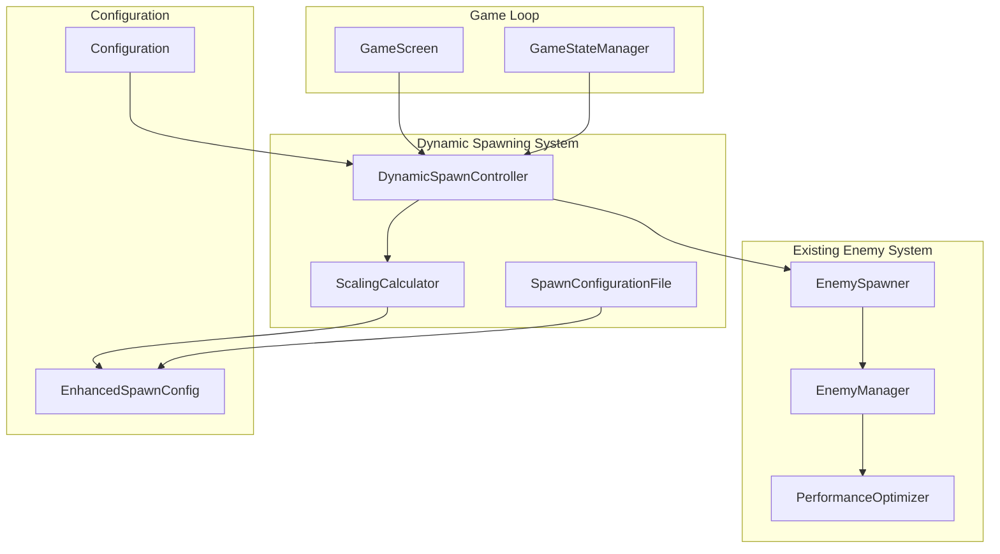

# Dynamic Enemy Spawning Design Document

## Overview

The Dynamic Enemy Spawning feature enhances the UberPlayground game's enemy system to provide progressive difficulty scaling through adaptive spawn rates and increased enemy limits. This system creates a more engaging gameplay experience by automatically adjusting challenge level based on player progression and game duration.

The feature integrates seamlessly with the existing LibGDX-based enemy management architecture, extending the current `EnemySpawner` and `EnemyManager` classes while maintaining backward compatibility. The system uses time-based scaling algorithms to progressively increase spawn rates from a base rate to double intensity after 60 seconds of gameplay.

Key capabilities include:
- **Dynamic Scaling**: Spawn rates increase continuously based on game duration using configurable scaling formulas
- **Enhanced Capacity**: Maximum enemy limit increased from 10 to 50 concurrent enemies
- **Performance Optimization**: Advanced enemy pooling and spatial partitioning to maintain 30+ FPS with increased enemy counts
- **Configuration Management**: External configuration system for tuning scaling parameters without code changes
- **Game State Integration**: Proper handling of pause/resume/restart scenarios with state preservation

## Architecture

### System Components

The dynamic spawning system extends the existing enemy architecture with several new components:



### Component Responsibilities

**DynamicSpawnController**: Central coordinator that manages the dynamic scaling logic, integrates with game state, and orchestrates spawn rate adjustments based on elapsed time.

**ScalingCalculator**: Mathematical engine that computes current spawn rates using configurable scaling formulas, handles different scaling curves (linear, exponential, logarithmic), and enforces maximum rate limits.

**GameStateManager**: New component that tracks game state transitions (playing, paused, game over) and coordinates with the spawn controller for proper state handling.

**EnhancedSpawnConfig**: Extended configuration system that supports runtime parameter updates, validation of configuration values, and fallback to safe defaults.

### Integration Points

The system integrates with existing components through well-defined interfaces:

- **EnemySpawner**: Extended to accept dynamic spawn intervals from DynamicSpawnController
- **EnemyManager**: Enhanced to handle increased enemy limits and performance monitoring
- **PerformanceOptimizer**: Expanded to monitor frame rates and trigger spawn rate reductions when performance degrades
- **Configuration**: Extended to include game duration tracking and state management

## Components and Interfaces

### DynamicSpawnController

```java
public class DynamicSpawnController {
    // Core state management
    private float gameDuration;
    private boolean isActive;
    private GameState currentState;
    
    // Scaling components
    private final ScalingCalculator scalingCalculator;
    private final EnhancedSpawnConfig config;
    
    // Integration points
    private final EnemySpawner enemySpawner;
    private final PerformanceOptimizer performanceOptimizer;
    
    public void update(float delta);
    public void setGameState(GameState state);
    public float getCurrentSpawnRate();
    public void resetForNewGame();
    public void pauseScaling();
    public void resumeScaling();
}
```

### ScalingCalculator

```java
public class ScalingCalculator {
    public enum ScalingType {
        LINEAR, EXPONENTIAL, LOGARITHMIC
    }
    
    private final EnhancedSpawnConfig config;
    
    public float calculateSpawnRate(float gameDuration);
    public float calculateScalingFactor(float gameDuration);
    public boolean isWithinPerformanceLimits(float proposedRate);
    public void setScalingType(ScalingType type);
}
```

### GameStateManager

```java
public class GameStateManager {
    public enum GameState {
        PLAYING, PAUSED, GAME_OVER, MENU
    }
    
    private GameState currentState;
    private final Array<GameStateListener> listeners;
    
    public void setState(GameState newState);
    public GameState getCurrentState();
    public void addListener(GameStateListener listener);
    public boolean isGameplayActive();
}
```

### EnhancedSpawnConfig

```java
public class EnhancedSpawnConfig {
    // Base configuration
    private float baseSpawnRate;
    private float maxSpawnRate;
    private int maxEnemies;
    
    // Scaling parameters
    private float scalingFactor;
    private float targetDuration;
    private ScalingType scalingType;
    
    // Performance thresholds
    private float minFrameRate;
    private float performanceReductionFactor;
    
    public void loadFromFile(String configPath);
    public void validateConfiguration();
    public void applyDefaults();
    public boolean isConfigurationValid();
}
```

## Data Models

### Spawn Rate Scaling Model

The system uses a mathematical model to calculate spawn rates based on game duration:

```
currentSpawnRate = baseSpawnRate * (1 + scalingFactor * progressionFunction(gameDuration))
```

Where `progressionFunction` can be:
- **Linear**: `gameDuration / targetDuration`
- **Exponential**: `(e^(gameDuration/targetDuration) - 1) / (e - 1)`
- **Logarithmic**: `log(1 + gameDuration) / log(1 + targetDuration)`

### Configuration Data Structure

```json
{
  "spawnConfiguration": {
    "baseSpawnRate": 0.2,
    "maxSpawnRate": 1.0,
    "maxEnemies": 50,
    "scalingFactor": 1.0,
    "targetDuration": 60.0,
    "scalingType": "LINEAR"
  },
  "performanceConfiguration": {
    "minFrameRate": 30.0,
    "performanceReductionFactor": 0.8,
    "monitoringInterval": 1.0
  },
  "gameStateConfiguration": {
    "preserveScalingOnPause": true,
    "resetOnGameOver": true,
    "resetOnNewGame": true
  }
}
```

### Game State Tracking

```java
public class GameSessionData {
    private float totalGameDuration;
    private float pausedDuration;
    private float activeGameDuration;
    private int enemiesSpawned;
    private float averageSpawnRate;
    private boolean scalingActive;
    
    // Performance metrics
    private float averageFrameRate;
    private int performanceReductions;
}
```
## Correctness Properties

*A property is a characteristic or behavior that should hold true across all valid executions of a system-essentially, a formal statement about what the system should do. Properties serve as the bridge between human-readable specifications and machine-verifiable correctness guarantees.*

### Property 1: Scaling Function Monotonicity and Determinism

*For any* two game durations where duration1 < duration2, the calculated spawn rate at duration2 should be greater than or equal to the spawn rate at duration1, and calling the scaling calculation multiple times with the same duration should always produce identical results.

**Validates: Requirements 1.2, 1.3**

### Property 2: Spawn Rate Bounds Enforcement

*For any* game duration, the calculated spawn rate should never exceed the configured maximum spawn rate threshold.

**Validates: Requirements 1.5**

### Property 3: Enemy Limit Enforcement

*For any* game state where the current enemy count is at the maximum limit, no new enemies should be spawned regardless of spawn rate, and when enemy count is below the limit, spawning should proceed according to the current spawn rate.

**Validates: Requirements 2.2, 2.3**

### Property 4: Enemy Count Tracking Accuracy

*For any* sequence of enemy spawn and removal operations, the tracked enemy count should always equal the actual number of active enemies in the system.

**Validates: Requirements 2.4**

### Property 5: Configuration Loading Completeness

*For any* valid configuration file containing base spawn rate, maximum spawn rate, and scaling factor parameters, all values should be correctly loaded and applied to the spawning system.

**Validates: Requirements 3.1, 3.2, 3.3**

### Property 6: Configuration Error Handling

*For any* invalid or missing configuration values, the system should fall back to safe default values and continue operating without errors.

**Validates: Requirements 3.4**

### Property 7: Runtime Configuration Updates

*For any* configuration change made during active gameplay, the new values should take effect immediately without requiring a game restart.

**Validates: Requirements 3.5**

### Property 8: Enemy Object Pooling

*For any* enemy spawning operation, enemy objects should be reused from a pool rather than creating new instances, minimizing garbage collection overhead.

**Validates: Requirements 4.2**

### Property 9: Distributed Spawning Operations

*For any* spawn request that would create multiple enemies, the spawn operations should be distributed across multiple frames rather than executing all in a single frame.

**Validates: Requirements 4.3**

### Property 10: Performance-Adaptive Spawn Rate

*For any* performance monitoring cycle where frame rate drops below the acceptable threshold, the spawn rate should be automatically reduced by the configured performance reduction factor.

**Validates: Requirements 4.4**

### Property 11: Pause/Resume State Preservation

*For any* pause and resume cycle during active gameplay, the scaling state (including game duration and current spawn rate) should be preserved and continue from where it left off.

**Validates: Requirements 5.1, 5.2, 5.5**

### Property 12: Game Over Scaling Reset

*For any* game over event, the scaling system should reset to base spawn rate and zero game duration for the next game session.

**Validates: Requirements 5.3**

## Error Handling

### Configuration Error Recovery

The system implements robust error handling for configuration-related issues:

**Invalid Configuration Values**: When configuration files contain invalid values (negative numbers, out-of-range values), the system validates each parameter and falls back to safe defaults while logging warnings.

**Missing Configuration Files**: If configuration files are missing or unreadable, the system uses built-in default values that ensure stable gameplay while attempting to create a new configuration file with default settings.

**Runtime Configuration Errors**: During runtime configuration updates, invalid values are rejected and the previous valid configuration is maintained, preventing system instability.

### Performance Degradation Handling

**Frame Rate Monitoring**: The system continuously monitors frame rate and automatically reduces spawn rates when performance drops below 30 FPS, implementing a feedback loop to maintain playable performance.

**Memory Pressure Detection**: When memory usage becomes excessive due to large enemy counts, the system triggers garbage collection and temporarily reduces spawn rates until memory pressure subsides.

**Emergency Spawn Limiting**: If enemy count approaches system limits or performance becomes critically poor, the system can temporarily halt spawning entirely until conditions improve.

### Game State Error Recovery

**State Transition Failures**: If game state transitions fail (e.g., pause/resume operations), the system maintains the last known good state and logs errors for debugging while continuing operation.

**Duration Tracking Errors**: If game duration tracking becomes inconsistent (negative values, overflow), the system resets duration tracking and scaling to prevent undefined behavior.

**Spawn Controller Failures**: If the dynamic spawn controller encounters errors, the system falls back to the original static spawning behavior to maintain basic gameplay functionality.

## Testing Strategy

### Dual Testing Approach

The dynamic enemy spawning system requires comprehensive testing using both unit tests and property-based tests to ensure correctness across all scenarios:

**Unit Tests** focus on:
- Specific examples and edge cases (game start spawn rate, 60-second doubling requirement)
- Integration points between components (DynamicSpawnController with EnemySpawner)
- Error conditions and recovery scenarios (invalid configuration handling)
- Game state transitions (pause/resume/game over scenarios)

**Property-Based Tests** focus on:
- Universal properties that hold for all inputs (scaling monotonicity, bounds enforcement)
- Comprehensive input coverage through randomization (all possible game durations and configurations)
- System behavior under stress conditions (high enemy counts, performance degradation)

Together, these approaches provide comprehensive coverage where unit tests catch concrete bugs and property tests verify general correctness across the entire input space.

### Property-Based Testing Configuration

The system uses **fast-check** (JavaScript/TypeScript) or **QuickCheck** (if using Scala/Java integration) for property-based testing with the following configuration:

- **Minimum 100 iterations** per property test to ensure adequate randomization coverage
- **Custom generators** for game durations (0-300 seconds), spawn rates (0.1-2.0), and enemy counts (0-50)
- **Shrinking strategies** to find minimal failing examples when properties fail
- **Timeout protection** to prevent infinite loops in scaling calculations

Each property test includes a comment tag referencing its design document property:
```java
// Feature: dynamic-enemy-spawning, Property 1: Scaling Function Monotonicity and Determinism
@Property
void scalingFunctionIsMonotonicAndDeterministic(@ForAll float duration1, @ForAll float duration2) {
    // Test implementation
}
```

### Integration Testing Strategy

**Performance Integration Tests**: Validate that the system maintains 30+ FPS with 50 enemies under realistic game conditions, using automated performance monitoring and statistical analysis.

**Game State Integration Tests**: Verify proper integration with the existing GameScreen lifecycle, including pause/resume functionality and game over transitions.

**Configuration Integration Tests**: Test the complete configuration loading and hot-reload functionality with various configuration file scenarios.

### Test Data Management

**Configuration Test Files**: Maintain a suite of test configuration files covering valid configurations, invalid configurations, and edge cases for comprehensive configuration testing.

**Performance Baselines**: Establish performance baselines for different enemy counts and scaling scenarios to detect performance regressions.

**State Transition Matrices**: Define comprehensive test matrices for all possible game state transitions to ensure complete coverage of state management scenarios.