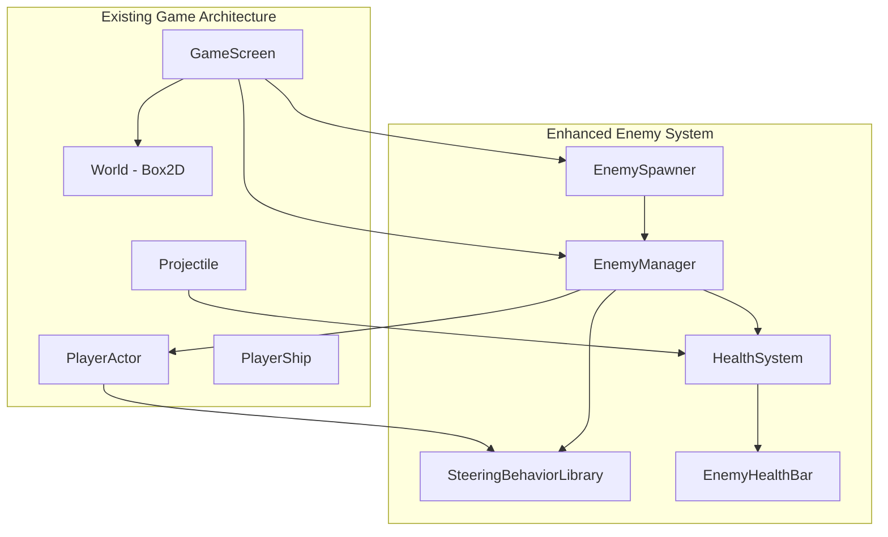

# Enhanced Enemy System Design

## Overview

The Enhanced Enemy System extends the existing LibGDX game architecture to provide dynamic enemy spawning, AI-driven behaviors, health management, and combat interactions. The system leverages the existing PlayerActor class as the foundation for enemy entities, integrating seamlessly with the current game loop, collision detection, and physics systems.

The design focuses on creating engaging gameplay through intelligent enemy behaviors while maintaining optimal performance for up to 10 concurrent enemies. The system introduces a comprehensive enemy lifecycle from spawning through behavior management to destruction, with proper integration into the existing GameScreen collision handling and game state management.

## Architecture

### System Components

The Enhanced Enemy System consists of five primary components that integrate with the existing game architecture:



**EnemySpawner**: Manages timed enemy creation with safe distance mechanics and spawn location validation.

**EnemyManager**: Central coordinator for enemy lifecycle, behavior assignment, and performance optimization.

**SteeringBehaviorLibrary**: Extended behavior system providing diverse AI movement patterns.

**HealthSystem**: Manages enemy health points, damage processing, and destruction logic.

**EnemyHealthBar**: Visual health representation rendered above each enemy.

### Integration Points

The system integrates with existing components through well-defined interfaces:

- **GameScreen**: Hosts EnemySpawner and EnemyManager, handles collision events
- **PlayerActor**: Extended to support enemy-specific behaviors and health management
- **Projectile**: Collision detection triggers health system damage processing
- **Box2D World**: Physics simulation for enemy movement and collision detection

## Components and Interfaces

### EnemySpawner

**Purpose**: Manages the creation and placement of new enemy entities with safe spawning mechanics.

**Key Responsibilities**:
- Timed enemy spawning every 5 seconds during active gameplay
- Safe distance validation (200-pixel radius from player)
- Spawn location collision detection and retry logic
- Maximum enemy count enforcement (10 enemies)

**Interface**:
```java
public class EnemySpawner {
    public void update(float delta)
    public void setSpawningEnabled(boolean enabled)
    public boolean canSpawn()
    private Vector2 findValidSpawnLocation()
    private boolean isLocationSafe(Vector2 position)
}
```

**Integration**: Called from GameScreen.render() during the main game loop.

### EnemyManager

**Purpose**: Central management system for all active enemies, coordinating their lifecycle and behaviors.

**Key Responsibilities**:
- Enemy registration and deregistration
- Behavior assignment and switching coordination
- Performance optimization through efficient updates
- Enemy removal and cleanup

**Interface**:
```java
public class EnemyManager {
    public void addEnemy(PlayerActor enemy)
    public void removeEnemy(PlayerActor enemy)
    public void updateAll(float delta)
    public Array<PlayerActor> getActiveEnemies()
    public int getEnemyCount()
}
```

**Integration**: Receives enemies from EnemySpawner, manages their lifecycle, and coordinates with HealthSystem for destruction.

### SteeringBehaviorLibrary

**Purpose**: Provides diverse AI movement patterns for enemy entities, extending the existing PlayerActor steering capabilities.

**Behavior Types**:
- **Wander**: Random exploration (existing)
- **Seek**: Direct pursuit of player (existing) 
- **Flee**: Evasive movement away from player
- **Patrol**: Waypoint-based movement patterns
- **Orbit**: Circular movement around player at fixed distance
- **Intercept**: Predictive movement to intercept player path
- **Flocking**: Group coordination behaviors (advanced)

**Interface**:
```java
public class SteeringBehaviorLibrary {
    public static Vector2 flee(PlayerActor enemy, Vector2 target)
    public static Vector2 patrol(PlayerActor enemy, Array<Vector2> waypoints)
    public static Vector2 orbit(PlayerActor enemy, Vector2 center, float radius)
    public static Vector2 intercept(PlayerActor enemy, PlayerShip target)
    public static Vector2 flock(PlayerActor enemy, Array<PlayerActor> neighbors)
}
```

**Integration**: Extended methods added to PlayerActor class, called during steering force calculation.

### HealthSystem

**Purpose**: Manages enemy health points, damage processing, and destruction logic with visual feedback.

**Key Responsibilities**:
- Health initialization (100 HP per enemy)
- Damage processing from projectile collisions (25 damage per hit)
- Enemy destruction when health reaches zero
- Health bar visual updates

**Interface**:
```java
public class HealthSystem {
    public void initializeHealth(PlayerActor enemy, int maxHealth)
    public void takeDamage(PlayerActor enemy, int damage)
    public boolean isAlive(PlayerActor enemy)
    public float getHealthPercentage(PlayerActor enemy)
    public void removeEnemy(PlayerActor enemy)
}
```

**Integration**: Called from GameScreen collision handling when projectiles hit enemies.

### EnemyHealthBar

**Purpose**: Visual representation of enemy health displayed above each enemy entity.

**Key Responsibilities**:
- Real-time health percentage display
- Efficient rendering only when health changes
- Proper positioning relative to enemy location
- Visual styling consistent with game aesthetics

**Interface**:
```java
public class EnemyHealthBar {
    public void render(ShapeRenderer renderer, Vector2 position, float healthPercentage)
    public void setDimensions(float width, float height)
    public void setColors(Color background, Color foreground)
}
```

**Integration**: Rendered during enemy act() method using existing ShapeRenderer infrastructure.

### EnemyBehaviorLabel

**Purpose**: Visual behavior label displayed below each enemy entity, opposite to the health bar.

**Key Responsibilities**:
- Display current steering behavior name (WANDER, SEEK, FLEE, PATROL, ORBIT, INTERCEPT, FLOCK)
- Color-coded labels for quick visual identification
- Positioned below enemy (35 pixels) to avoid obstruction
- Real-time updates as enemy behavior changes
- Performance-optimized rendering with graceful error handling

**Interface**:
```java
public class EnemyBehaviorLabel {
    public void render(ShapeRenderer renderer, Camera camera, Vector2 position, 
                      SteeringBehaviorType behaviorType, boolean forceRender)
    public static void initialize()
    public static void dispose()
}
```

**Integration**: Rendered during enemy act() method using existing ShapeRenderer infrastructure. Behavior labels are displayed below enemies with the following color scheme:
- WANDER: Yellow
- SEEK: Green
- FLEE: Red
- PATROL: Blue
- ORBIT: Cyan
- INTERCEPT: Magenta
- FLOCK: Orange

**Positioning**: 
- Health bar: 30 pixels above enemy center
- Behavior label: 35 pixels below enemy center
- Label dimensions: 1.5 units wide, 0.4 units tall
- Text scale: 1.0 for readability

**Integration**: Added to GameScreen constructor for initialization and dispose method for cleanup.

## Data Models

### Enemy Entity Model

Enemies are represented using the existing PlayerActor class with additional properties for enemy-specific functionality:

```java
public class PlayerActor extends AnimatedPhysicsActor {
    // Existing PlayerActor properties...
    
    // Enemy-specific additions
    private boolean isEnemy;
    private int currentHealth;
    private int maxHealth;
    private SteeringBehaviorType currentBehavior;
    private float behaviorSwitchTimer;
    private float behaviorSwitchInterval;
    private EnemyHealthBar healthBar;
    private Array<Vector2> patrolWaypoints; // For patrol behavior
    private int currentWaypointIndex;
    private float orbitAngle; // For orbit behavior
}
```

### Behavior State Model

Each enemy maintains individual behavior state for autonomous switching:

```java
public enum SteeringBehaviorType {
    WANDER, SEEK, FLEE, PATROL, ORBIT, INTERCEPT, FLOCK
}

public class BehaviorState {
    private SteeringBehaviorType currentType;
    private float switchTimer;
    private float switchInterval; // Random 2-10 seconds
    private Map<String, Object> behaviorData; // Behavior-specific state
}
```

### Health Data Model

Health information is managed through a component-based approach:

```java
public class HealthComponent {
    private int currentHealth;
    private int maxHealth;
    private boolean isAlive;
    private float lastDamageTime;
    
    public float getHealthPercentage() {
        return (float) currentHealth / maxHealth;
    }
}
```

### Spawn Configuration Model

Spawning parameters are configurable for gameplay balancing:

```java
public class SpawnConfiguration {
    public static final float SPAWN_INTERVAL = 5.0f; // seconds
    public static final float SAFE_DISTANCE = 200.0f; // pixels
    public static final int MAX_SPAWN_ATTEMPTS = 10;
    public static final int MAX_ENEMIES = 10;
    public static final int ENEMY_HEALTH = 100;
    public static final int PROJECTILE_DAMAGE = 25;
}
```
## Correctness Properties

*A property is a characteristic or behavior that should hold true across all valid executions of a system-essentially, a formal statement about what the system should do. Properties serve as the bridge between human-readable specifications and machine-verifiable correctness guarantees.*

After analyzing the acceptance criteria, I identified several properties that can be combined for more comprehensive testing. Properties that test similar aspects (like collision detection accuracy) or sequential operations (like damage then projectile removal) can be consolidated into single, more powerful properties.

### Property 1: Enemy Spawning Timing Consistency

*For any* gameplay session running for a measurable duration, the number of enemy spawn attempts should match the expected count based on the 5-second spawn interval, accounting for maximum enemy limits and failed spawn attempts.

**Validates: Requirements 1.1, 8.1, 8.2**

### Property 2: Safe Distance Spawn Enforcement

*For any* player position and spawn attempt, no enemy should be spawned within a 200-pixel radius of the player position.

**Validates: Requirements 1.3**

### Property 3: Spawn Location Distribution and Collision Avoidance

*For any* set of spawn attempts, spawn locations should be distributed across the game map and not overlap with existing game entities.

**Validates: Requirements 1.2, 1.5**

### Property 4: Graceful Spawn Failure Handling

*For any* spawn cycle where no valid location exists after 10 attempts, the spawner should skip the cycle without crashing or infinite loops.

**Validates: Requirements 1.4**

### Property 5: Independent Behavior Management

*For any* enemy, its behavior switching should occur independently with random intervals between 2-10 seconds, and behavior changes should not affect other enemies.

**Validates: Requirements 2.1, 2.2, 2.3, 2.5, 2.6**

### Property 6: Seek Behavior Targeting Accuracy

*For any* enemy using seek behavior, its movement should be directed toward the current player position.

**Validates: Requirements 2.4**

### Property 7: Flee Behavior Directional Correctness

*For any* enemy using flee behavior, its movement should be directed away from the player position.

**Validates: Requirements 3.2**

### Property 8: Patrol Behavior Waypoint Following

*For any* enemy using patrol behavior with defined waypoints, it should follow the waypoint sequence in order.

**Validates: Requirements 3.3**

### Property 9: Orbit Behavior Distance Maintenance

*For any* enemy using orbit behavior, it should maintain a consistent distance from the player while circling.

**Validates: Requirements 3.4**

### Property 10: Intercept Behavior Predictive Movement

*For any* enemy using intercept behavior, it should move toward predicted player positions based on current player velocity.

**Validates: Requirements 3.5**

### Property 11: Flocking Behavior Group Coordination

*For any* group of enemies with flocking behavior enabled, they should coordinate their movements to maintain group cohesion.

**Validates: Requirements 3.6**

### Property 12: Health Initialization and Management

*For any* spawned enemy, it should start with exactly 100 health points and maintain accurate health tracking throughout its lifetime.

**Validates: Requirements 4.1**

### Property 13: Health Bar Visual Accuracy

*For any* enemy with a health bar, the displayed health percentage should accurately reflect the current health value and update immediately when health changes.

**Validates: Requirements 4.2, 4.5**

### Property 14: Projectile Damage Processing

*For any* projectile collision with an enemy, the enemy health should be reduced by exactly 25 points before the projectile is removed.

**Validates: Requirements 4.3, 5.1, 5.2**

### Property 15: Enemy Destruction on Zero Health

*For any* enemy whose health reaches zero or below, it should be immediately removed from the game.

**Validates: Requirements 4.4, 8.4**

### Property 16: Collision Detection Accuracy

*For any* game entities with overlapping collision bounds, the collision detection system should accurately identify and process the collision.

**Validates: Requirements 5.3, 6.6, 6.7**

### Property 17: Single Collision Processing Per Frame

*For any* projectile in a single game frame, it should process at most one collision and not trigger multiple collision events.

**Validates: Requirements 5.4**

### Property 18: Projectile Non-Interference

*For any* two projectiles with overlapping paths, they should pass through each other without collision.

**Validates: Requirements 5.5**

### Property 19: Game Over Trigger Conditions

*For any* collision between the player and an enemy or wall boundary, the game should immediately transition to the game over state.

**Validates: Requirements 6.1, 6.2, 6.3**

### Property 20: Game Over State Management

*For any* game over event, all game entity updates should pause, enemy spawning should stop, and all projectiles should be cleared.

**Validates: Requirements 7.1, 7.2, 7.3**

### Property 21: Game Reset Functionality

*For any* restart action after game over, all game entities should return to their initial state and normal gameplay should resume.

**Validates: Requirements 7.4, 7.5**

### Property 22: Enemy Count Limit Enforcement

*For any* point during gameplay, the number of active enemies should never exceed 10.

**Validates: Requirements 8.1, 8.2**

### Property 23: Health Bar Rendering Optimization

*For any* enemy health bar, rendering updates should only occur when the health value actually changes.

**Validates: Requirements 8.3**

### Property 24: Behavior Label Visibility and Positioning

*For any* enemy with a behavior label, the label should be clearly visible below the enemy without obstruction, displaying the correct behavior name with appropriate color coding.

**Validates: Requirements 8.6**

## Error Handling

The Enhanced Enemy System implements comprehensive error handling to ensure robust gameplay:

### Spawn System Error Handling

**Invalid Spawn Locations**: When no valid spawn location is found after 10 attempts, the system gracefully skips the spawn cycle and logs the event for debugging. This prevents infinite loops and maintains game performance.

**Memory Constraints**: If enemy creation fails due to memory constraints, the system reduces the maximum enemy count temporarily and attempts to free unused resources.

**Physics World Errors**: Box2D body creation failures are caught and logged, with the system attempting to retry spawn after a brief delay.

### Behavior System Error Handling

**Invalid Behavior States**: If an enemy receives an invalid behavior assignment, it defaults to the wander behavior to maintain functionality.

**Behavior Switching Failures**: Timer-based behavior switching includes validation to ensure new behaviors are different from current ones, preventing unnecessary state changes.

**Pathfinding Errors**: When waypoint-based behaviors encounter invalid paths, they fall back to seek behavior targeting the player.

### Health System Error Handling

**Invalid Damage Values**: Negative damage values are rejected, and damage exceeding current health is clamped to prevent underflow.

**Health Bar Rendering Failures**: If health bar rendering fails, the system continues without visual health feedback while logging the error.

**Destruction Cleanup Errors**: Failed enemy removal attempts are retried in subsequent frames to prevent memory leaks.

### Physics Body Cleanup Error Handling

**Box2D Crash Prevention**: Physics body destruction is deferred until after the physics step completes to prevent crashes during collision callbacks. Enemies are queued for cleanup and processed in a separate phase.

**Memory Leak Prevention**: The deferred cleanup system ensures all physics bodies are properly destroyed when enemies are removed, preventing invisible collision detection from dead enemies.

**Game State Integration**: Cleanup queues are properly cleared during game over and game reset states to prevent stale references.

### Collision System Error Handling

**Null Reference Protection**: All collision handling includes null checks for fixtures and user data to prevent crashes.

**Duplicate Collision Events**: The system tracks processed collisions per frame to prevent duplicate damage or removal events.

**Physics Synchronization**: Collision events that occur during physics world stepping are queued and processed after the physics update.

## Testing Strategy

The Enhanced Enemy System employs a dual testing approach combining unit tests for specific scenarios and property-based tests for comprehensive coverage.

### Unit Testing Approach

Unit tests focus on specific examples, edge cases, and integration points:

**Spawn System Tests**:
- Specific spawn location validation scenarios
- Edge cases like player at map boundaries
- Integration with existing GameScreen collision detection

**Behavior System Tests**:
- Individual behavior implementations with known inputs
- Behavior switching edge cases (timer expiration, invalid states)
- Integration with existing PlayerActor steering force calculation

**Health System Tests**:
- Specific damage scenarios (single hit, multiple hits, overkill)
- Health bar rendering with various health percentages
- Integration with collision detection and enemy removal

**Game State Tests**:
- Game over trigger scenarios
- Restart functionality with various game states
- Integration with existing GameScreen state management

### Property-Based Testing Configuration

Property-based tests verify universal properties across randomized inputs using **fast-check** for JavaScript/TypeScript or **junit-quickcheck** for Java:

**Configuration Requirements**:
- Minimum 100 iterations per property test
- Each test tagged with format: **Feature: enhanced-enemy-system, Property {number}: {property_text}**
- Randomized test data generation for positions, timings, and game states

**Test Data Generators**:
- Random spawn positions within game boundaries
- Random player positions and velocities
- Random enemy configurations and health values
- Random collision scenarios and timing

**Property Test Examples**:

```java
// Property 2: Safe Distance Spawn Enforcement
@Property
@Label("Feature: enhanced-enemy-system, Property 2: Safe Distance Spawn Enforcement")
void safeDistanceSpawnEnforcement(@ForAll Vector2 playerPosition, @ForAll Vector2 spawnAttempt) {
    // Test that no spawn occurs within 200 pixels of player
    boolean shouldSpawn = enemySpawner.isLocationSafe(spawnAttempt, playerPosition);
    float distance = playerPosition.dst(spawnAttempt);
    
    if (distance < 200.0f) {
        assertFalse(shouldSpawn);
    }
}

// Property 14: Projectile Damage Processing
@Property  
@Label("Feature: enhanced-enemy-system, Property 14: Projectile Damage Processing")
void projectileDamageProcessing(@ForAll PlayerActor enemy, @ForAll Projectile projectile) {
    int initialHealth = enemy.getCurrentHealth();
    
    // Simulate collision
    healthSystem.processProjectileHit(enemy, projectile);
    
    assertEquals(initialHealth - 25, enemy.getCurrentHealth());
    assertFalse(projectile.isActive());
}
```

### Performance Testing

While most performance requirements are validated through profiling rather than unit tests, the system includes specific performance-related properties:

**Memory Management**: Property tests verify that destroyed enemies are properly cleaned up and don't accumulate in memory.

**Update Efficiency**: Tests ensure that health bar updates only occur when health values change, preventing unnecessary rendering overhead.

**Collision Optimization**: Tests verify that collision processing remains efficient with maximum enemy counts.

The testing strategy ensures comprehensive coverage while maintaining fast test execution and clear failure reporting for debugging and maintenance.