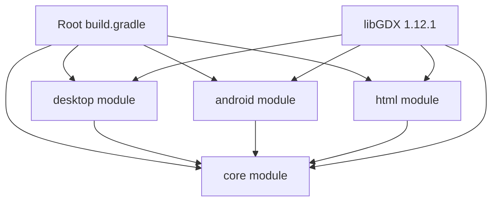

# Design Document: libGDX and Gradle Update

## Overview

This design specifies the technical approach for updating the UberPlayground project from libGDX 1.9.5 and Gradle 2.14.1 to modern versions. The update involves coordinated changes across build configuration files, dependency declarations, and source code to migrate from deprecated APIs while maintaining full cross-platform functionality.

### Target Versions

Based on compatibility research and current stable releases:

- **Gradle**: 8.5 (released November 2023, stable LTS release)
- **libGDX**: 1.12.1 (latest stable as of 2024)
- **Android Gradle Plugin**: 8.2.0 (compatible with Gradle 8.5)
- **Java**: 11 (minimum for Gradle 8.x and Android Gradle Plugin 8.x)
- **GWT**: 2.10.0 (latest stable, compatible with libGDX 1.12.1)
- **GWT Gradle Plugin**: 1.1.30 (compatible with Gradle 8.x)

### Key Migration Challenges

1. **LWJGL2 to LWJGL3 Backend**: The desktop module uses the deprecated LWJGL2 backend (`com.badlogic.gdx.backends.lwjgl`), which must be migrated to LWJGL3 (`com.badlogic.gdx.backends.lwjgl3`)
2. **Gradle Dependency Syntax**: Replace deprecated `compile` configuration with `implementation` and `api`
3. **Android SDK Updates**: Increase minSdkVersion from 8 to 21, remove deprecated armeabi architecture
4. **Repository Changes**: Remove deprecated jcenter() repository
5. **GWT Plugin Migration**: Update to modern GWT Gradle plugin with different configuration syntax

## Architecture

### Build System Architecture

The project uses a multi-module Gradle build with the following structure:

```
root/
├── build.gradle (root configuration, shared dependencies)
├── settings.gradle (module declarations)
├── gradle.properties (build properties)
├── gradle/wrapper/ (Gradle wrapper configuration)
├── core/ (shared game logic)
│   └── build.gradle
├── desktop/ (LWJGL3 backend)
│   └── build.gradle
├── android/ (Android backend)
│   └── build.gradle
└── html/ (GWT backend)
    └── build.gradle
```

### Dependency Flow



### Module Responsibilities

- **core**: Platform-agnostic game logic, depends on libGDX core, Box2D, Box2DLights, gdx-ai
- **desktop**: LWJGL3 backend for desktop platforms (Windows, macOS, Linux)
- **android**: Android backend with native library extraction
- **html**: GWT backend for web deployment

## Components and Interfaces

### 1. Gradle Wrapper Configuration

**File**: `gradle/wrapper/gradle-wrapper.properties`

**Changes**:
```properties
distributionUrl=https\://services.gradle.org/distributions/gradle-8.5-all.zip
```

**Rationale**: Gradle 8.5 is a stable LTS release with excellent performance and compatibility with modern tooling.

### 2. Root Build Configuration

**File**: `build.gradle`

**Key Changes**:

1. **Buildscript Dependencies**:
```groovy
buildscript {
    repositories {
        mavenCentral()
        google()
    }
    dependencies {
        classpath 'org.gretty:gretty:4.1.0'
        classpath 'com.android.tools.build:gradle:8.2.0'
    }
}
```

2. **Version Properties**:
```groovy
ext {
    appName = "Uber-Playground"
    gdxVersion = '1.12.1'
    box2DLightsVersion = '1.5'
    ashleyVersion = '1.7.4'
    aiVersion = '1.8.2'
}
```

3. **Repository Configuration**:
```groovy
repositories {
    mavenLocal()
    mavenCentral()
    google()
    maven { url "https://oss.sonatype.org/content/repositories/snapshots/" }
    maven { url "https://oss.sonatype.org/content/repositories/releases/" }
}
```

**Removed**: `jcenter()` (deprecated and shut down)

### 3. Desktop Module Configuration

**File**: `desktop/build.gradle`

**Changes**:

1. **Java Version**:
```groovy
sourceCompatibility = 11
targetCompatibility = 11
```

2. **Dependencies** (LWJGL2 → LWJGL3):
```groovy
dependencies {
    implementation project(":core")
    implementation "com.badlogicgames.gdx:gdx-backend-lwjgl3:$gdxVersion"
    implementation "com.badlogicgames.gdx:gdx-platform:$gdxVersion:natives-desktop"
    implementation "com.badlogicgames.gdx:gdx-box2d-platform:$gdxVersion:natives-desktop"
    implementation "com.badlogicgames.gdx:gdx-tools:$gdxVersion"
    implementation "com.badlogicgames.gdx:gdx-ai:$aiVersion"
}
```

**Note**: Changed from `compile` to `implementation`, and from `gdx-backend-lwjgl` to `gdx-backend-lwjgl3`.

### 4. Desktop Launcher Source Code

**File**: `desktop/src/com/plv/uberplayground/desktop/DesktopLauncher.java`

**Migration Required**: LWJGL2 to LWJGL3 API changes

**Current Code**:
```java
import com.badlogic.gdx.backends.lwjgl.LwjglApplication;
import com.badlogic.gdx.backends.lwjgl.LwjglApplicationConfiguration;

public class DesktopLauncher {
    public static void main (String[] arg) {
        LwjglApplicationConfiguration config = new LwjglApplicationConfiguration();
        config.width = 400;
        config.height = 240;
        new LwjglApplication(new UberPlayground(), config);
    }
}
```

**Updated Code**:
```java
import com.badlogic.gdx.backends.lwjgl3.Lwjgl3Application;
import com.badlogic.gdx.backends.lwjgl3.Lwjgl3ApplicationConfiguration;

public class DesktopLauncher {
    public static void main (String[] arg) {
        Lwjgl3ApplicationConfiguration config = new Lwjgl3ApplicationConfiguration();
        config.setWindowedMode(400, 240);
        config.setTitle("Uber-Playground");
        new Lwjgl3Application(new UberPlayground(), config);
    }
}
```

**API Changes**:
- `LwjglApplication` → `Lwjgl3Application`
- `LwjglApplicationConfiguration` → `Lwjgl3ApplicationConfiguration`
- `config.width` and `config.height` → `config.setWindowedMode(width, height)`
- Added `config.setTitle()` (recommended practice)

### 5. Android Module Configuration

**File**: `android/build.gradle`

**Changes**:

1. **Android Configuration Block**:
```groovy
android {
    namespace 'com.plv.uberplayground'
    compileSdk 34
    
    sourceSets {
        main {
            manifest.srcFile 'AndroidManifest.xml'
            java.srcDirs = ['src']
            aidl.srcDirs = ['src']
            renderscript.srcDirs = ['src']
            res.srcDirs = ['res']
            assets.srcDirs = ['assets']
            jniLibs.srcDirs = ['libs']
        }
    }
    
    packagingOptions {
        exclude 'META-INF/robovm/ios/robovm.xml'
        exclude 'META-INF/INDEX.LIST'
        exclude 'META-INF/*.SF'
        exclude 'META-INF/*.DSA'
        exclude 'META-INF/*.RSA'
    }
    
    defaultConfig {
        applicationId "com.plv.uberplayground"
        minSdk 21
        targetSdk 34
        versionCode 1
        versionName "1.0"
    }
    
    buildTypes {
        release {
            minifyEnabled false
            proguardFiles getDefaultProguardFile('proguard-android-optimize.txt'), 'proguard-project.txt'
        }
    }
    
    compileOptions {
        sourceCompatibility JavaVersion.VERSION_11
        targetCompatibility JavaVersion.VERSION_11
    }
}
```

**Key Changes**:
- Added `namespace` (required in AGP 8.x)
- `buildToolsVersion` removed (auto-selected by AGP)
- `compileSdkVersion 25` → `compileSdk 34`
- `minSdkVersion 8` → `minSdk 21`
- `targetSdkVersion 25` → `targetSdk 34`
- Added `compileOptions` for Java 11
- Added additional packaging exclusions for common conflicts

2. **Dependencies**:
```groovy
configurations { natives }

dependencies {
    implementation project(":core")
    implementation "com.badlogicgames.gdx:gdx-backend-android:$gdxVersion"
    
    natives "com.badlogicgames.gdx:gdx-platform:$gdxVersion:natives-armeabi-v7a"
    natives "com.badlogicgames.gdx:gdx-platform:$gdxVersion:natives-arm64-v8a"
    natives "com.badlogicgames.gdx:gdx-platform:$gdxVersion:natives-x86"
    natives "com.badlogicgames.gdx:gdx-platform:$gdxVersion:natives-x86_64"
    
    implementation "com.badlogicgames.gdx:gdx-box2d:$gdxVersion"
    natives "com.badlogicgames.gdx:gdx-box2d-platform:$gdxVersion:natives-armeabi-v7a"
    natives "com.badlogicgames.gdx:gdx-box2d-platform:$gdxVersion:natives-arm64-v8a"
    natives "com.badlogicgames.gdx:gdx-box2d-platform:$gdxVersion:natives-x86"
    natives "com.badlogicgames.gdx:gdx-box2d-platform:$gdxVersion:natives-x86_64"
    
    implementation "com.badlogicgames.box2dlights:box2dlights:$box2DLightsVersion"
    implementation "com.badlogicgames.gdx:gdx-ai:$aiVersion"
}
```

**Removed**: `natives-armeabi` (deprecated architecture, not supported on modern Android)

3. **copyAndroidNatives Task**:
```groovy
task copyAndroidNatives() {
    file("libs/armeabi-v7a/").mkdirs();
    file("libs/arm64-v8a/").mkdirs();
    file("libs/x86_64/").mkdirs();
    file("libs/x86/").mkdirs();

    configurations.natives.files.each { jar ->
        def outputDir = null
        if (jar.name.endsWith("natives-arm64-v8a.jar")) outputDir = file("libs/arm64-v8a")
        if (jar.name.endsWith("natives-armeabi-v7a.jar")) outputDir = file("libs/armeabi-v7a")
        if (jar.name.endsWith("natives-x86_64.jar")) outputDir = file("libs/x86_64")
        if (jar.name.endsWith("natives-x86.jar")) outputDir = file("libs/x86")
        if (outputDir != null) {
            copy {
                from zipTree(jar)
                into outputDir
                include "*.so"
            }
        }
    }
}

tasks.whenTaskAdded { packageTask ->
    if (packageTask.name.contains("package")) {
        packageTask.dependsOn 'copyAndroidNatives'
    }
}
```

**Removed**: armeabi directory creation and extraction logic

### 6. HTML Module Configuration

**File**: `html/build.gradle`

**Changes**:

1. **Plugin Application**:
```groovy
apply plugin: "java"
apply plugin: "war"
apply plugin: "org.gretty"
```

**Note**: The GWT plugin is now applied via the buildscript classpath and configured differently.

2. **GWT Configuration**:
```groovy
gwt {
    gwtVersion = '2.10.0'
    maxHeapSize = '2G'
    minHeapSize = '1G'
    
    src = files(file("src/"))
    modules 'com.plv.uberplayground.GdxDefinition'
    devModules 'com.plv.uberplayground.GdxDefinitionSuperdev'
    
    compiler {
        strict = true
        enableClosureCompiler = true
        disableCastChecking = true
    }
}

gretty {
    httpPort = 8080
    contextPath = "/"
    servletContainer = "jetty11"
}
```

**Changes**:
- `gwtVersion` updated to 2.10.0
- Increased heap sizes for better performance
- Replaced jetty plugin with gretty plugin

3. **Dependencies**:
```groovy
dependencies {
    implementation project(":core")
    implementation "com.badlogicgames.gdx:gdx-backend-gwt:$gdxVersion"
    implementation "com.badlogicgames.gdx:gdx:$gdxVersion:sources"
    implementation "com.badlogicgames.gdx:gdx-backend-gwt:$gdxVersion:sources"
    implementation "com.badlogicgames.gdx:gdx-box2d:$gdxVersion:sources"
    implementation "com.badlogicgames.gdx:gdx-box2d-gwt:$gdxVersion:sources"
    implementation "com.badlogicgames.box2dlights:box2dlights:$box2DLightsVersion:sources"
    implementation "com.badlogicgames.gdx:gdx-ai:$aiVersion:sources"
}
```

4. **Tasks**:
```groovy
task dist(dependsOn: [clean, compileGwt]) {
    doLast {
        file("build/dist").mkdirs()
        copy {
            from "build/gwt/out"
            into "build/dist"
        }
        copy {
            from "webapp"
            into "build/dist"
        }
        copy {
            from "war"
            into "build/dist"
        }
    }
}

task superDev(type: org.wisepersist.gradle.plugins.gwt.GwtSuperDev) {
    dependsOn startHttpServer
    doFirst {
        gwt.modules = gwt.devModules
    }
}
```

### 7. Core Module Configuration

**File**: `core/build.gradle`

**Changes**:

```groovy
apply plugin: "java"

sourceCompatibility = 11
targetCompatibility = 11

[compileJava, compileTestJava]*.options*.encoding = 'UTF-8'

sourceSets.main.java.srcDirs = [ "src/" ]

dependencies {
    api "com.badlogicgames.gdx:gdx:$gdxVersion"
    api "com.badlogicgames.gdx:gdx-box2d:$gdxVersion"
    api "com.badlogicgames.box2dlights:box2dlights:$box2DLightsVersion"
    api "com.badlogicgames.gdx:gdx-ai:$aiVersion"
}

eclipse.project {
    name = appName + "-core"
}
```

**Changes**:
- `sourceCompatibility` and `targetCompatibility` updated to 11
- `compile` → `api` (core module exposes these dependencies to dependent modules)

### 8. Gradle Properties

**File**: `gradle.properties`

**Changes**:

```properties
org.gradle.daemon=true
org.gradle.jvmargs=-Xms256m -Xmx2048m
org.gradle.configureondemand=false
org.gradle.caching=true
org.gradle.parallel=true

android.useAndroidX=true
android.enableJetifier=false
android.nonTransitiveRClass=true
```

**Changes**:
- Increased max heap from 1024m to 2048m (Gradle 8.x and AGP 8.x need more memory)
- Disabled `configureondemand` (can cause issues with modern Gradle)
- Enabled `caching` and `parallel` for better performance
- Added AndroidX properties (required for modern Android development)

## Data Models

### Build Configuration Model

The build configuration follows a hierarchical model:

```
BuildConfiguration
├── GradleWrapper
│   └── distributionUrl: String
├── RootBuildScript
│   ├── repositories: List<Repository>
│   ├── dependencies: List<Dependency>
│   └── ext: Map<String, String>
├── ModuleConfigurations
│   ├── CoreModule
│   │   ├── sourceCompatibility: JavaVersion
│   │   └── dependencies: List<Dependency>
│   ├── DesktopModule
│   │   ├── sourceCompatibility: JavaVersion
│   │   ├── dependencies: List<Dependency>
│   │   └── tasks: List<Task>
│   ├── AndroidModule
│   │   ├── androidConfig: AndroidConfig
│   │   ├── dependencies: List<Dependency>
│   │   └── tasks: List<Task>
│   └── HtmlModule
│       ├── gwtConfig: GwtConfig
│       ├── dependencies: List<Dependency>
│       └── tasks: List<Task>
└── GradleProperties
    └── properties: Map<String, String>
```

### Dependency Version Model

```
DependencyVersions
├── gradle: "8.5"
├── libGDX: "1.12.1"
├── androidGradlePlugin: "8.2.0"
├── gwt: "2.10.0"
├── gwtGradlePlugin: "1.1.30"
├── box2DLights: "1.5"
├── gdxAI: "1.8.2"
├── java: "11"
├── androidCompileSdk: 34
├── androidMinSdk: 21
└── androidTargetSdk: 34
```


## Migration Steps

The migration must be performed in a specific order to avoid build failures:

### Phase 1: Gradle Wrapper Update

1. Update `gradle/wrapper/gradle-wrapper.properties`:
   - Change `distributionUrl` to Gradle 8.5
2. Run `./gradlew wrapper --gradle-version 8.5` to regenerate wrapper files
3. Verify: `./gradlew --version` should show Gradle 8.5

### Phase 2: Root Build Configuration

1. Update `build.gradle`:
   - Update buildscript dependencies (Android Gradle Plugin to 8.2.0)
   - Remove GWT plugin from buildscript (will be applied differently)
   - Update version properties (gdxVersion, box2DLightsVersion, aiVersion)
   - Remove `jcenter()` from repositories
   - Add `google()` repository
2. Update `gradle.properties`:
   - Increase heap size
   - Add Android properties
   - Enable caching and parallel builds

### Phase 3: Core Module Update

1. Update `core/build.gradle`:
   - Change `sourceCompatibility` and `targetCompatibility` to 11
   - Replace `compile` with `api` in dependencies
2. No source code changes needed (core module uses stable libGDX APIs)

### Phase 4: Desktop Module Update

1. Update `desktop/build.gradle`:
   - Change `sourceCompatibility` and `targetCompatibility` to 11
   - Replace `compile` with `implementation`
   - Change `gdx-backend-lwjgl` to `gdx-backend-lwjgl3`
2. Update `desktop/src/com/plv/uberplayground/desktop/DesktopLauncher.java`:
   - Change imports from `lwjgl` to `lwjgl3`
   - Update configuration API calls
3. Test: `./gradlew desktop:run`

### Phase 5: Android Module Update

1. Update `android/build.gradle`:
   - Add `namespace` property
   - Update SDK versions (compileSdk 34, minSdk 21, targetSdk 34)
   - Add `compileOptions` for Java 11
   - Replace `compile` with `implementation`
   - Remove `natives-armeabi` dependencies
   - Update `copyAndroidNatives` task to remove armeabi
   - Add `whenTaskAdded` hook to ensure natives are copied before packaging
2. No source code changes needed (Android backend APIs are stable)
3. Test: `./gradlew android:assembleDebug`

### Phase 6: HTML Module Update

1. Update root `build.gradle`:
   - Add gretty plugin to buildscript classpath
2. Update `html/build.gradle`:
   - Apply gretty plugin
   - Update GWT version to 2.10.0
   - Update GWT configuration syntax
   - Replace `compile` with `implementation`
   - Update task configurations
3. No source code changes needed (GWT backend APIs are stable)
4. Test: `./gradlew html:dist`

### Phase 7: Verification

1. Clean build: `./gradlew clean build`
2. Test all modules:
   - Desktop: `./gradlew desktop:run`
   - Android: `./gradlew android:assembleDebug`
   - HTML: `./gradlew html:dist`
3. Verify no deprecation warnings in build output

## Error Handling

### Build Errors

**Error**: "Namespace not specified"
- **Cause**: Android Gradle Plugin 8.x requires namespace in build.gradle
- **Solution**: Add `namespace 'com.plv.uberplayground'` to android block

**Error**: "Could not find com.badlogicgames.gdx:gdx-backend-lwjgl"
- **Cause**: LWJGL2 backend not updated to LWJGL3
- **Solution**: Change dependency to `gdx-backend-lwjgl3` and update source code

**Error**: "Unsupported class file major version"
- **Cause**: Java version mismatch
- **Solution**: Ensure Java 11+ is installed and JAVA_HOME is set correctly

**Error**: "Configuration 'compile' is obsolete"
- **Cause**: Using deprecated Gradle dependency configuration
- **Solution**: Replace `compile` with `implementation` or `api`

**Error**: "Could not resolve all files for configuration ':android:debugRuntimeClasspath'"
- **Cause**: Missing or incorrect native dependencies
- **Solution**: Verify natives configuration and copyAndroidNatives task

### Runtime Errors

**Error**: Desktop application fails to start with "UnsatisfiedLinkError"
- **Cause**: LWJGL3 native libraries not found
- **Solution**: Verify `gdx-platform:natives-desktop` dependency is present

**Error**: Android app crashes on startup
- **Cause**: Missing native libraries for device architecture
- **Solution**: Verify copyAndroidNatives task ran and libs/ folders contain .so files

**Error**: HTML build produces empty output
- **Cause**: GWT compilation failed silently
- **Solution**: Check build logs for GWT compiler errors, verify source dependencies

### Deprecation Warnings

**Warning**: "jcenter() is deprecated"
- **Solution**: Remove jcenter() from repositories block

**Warning**: "The compile configuration has been deprecated"
- **Solution**: Replace with implementation or api

**Warning**: "buildToolsVersion is deprecated"
- **Solution**: Remove buildToolsVersion line (auto-selected by AGP)

## Testing Strategy

### Unit Testing Approach

The update itself is primarily a build configuration change with minimal code changes. Unit testing will focus on:

1. **Build Configuration Validation**:
   - Test that all Gradle tasks complete successfully
   - Verify no deprecation warnings in build output
   - Confirm correct dependency resolution

2. **Module Integration Tests**:
   - Desktop: Verify application launches and renders correctly
   - Android: Verify APK builds and installs on test device
   - HTML: Verify web application builds and loads in browser

3. **Specific Test Cases**:
   - Test LWJGL3 window creation with various configurations
   - Test Android native library extraction for all architectures
   - Test GWT compilation with all source dependencies

### Property-Based Testing Approach

Property-based testing will be used to verify build system correctness across different scenarios:

1. **Dependency Resolution Properties**:
   - For any valid module configuration, dependency resolution should complete without errors
   - For any libGDX extension, the version should be compatible with the core libGDX version

2. **Build Task Properties**:
   - For any module, running clean followed by build should produce consistent output
   - For any module, running a task twice should produce the same result (idempotence)

3. **Native Library Properties**:
   - For any Android architecture, the copyAndroidNatives task should extract exactly one .so file per native dependency
   - For any native dependency, the extracted library should match the architecture specified in the dependency name

### Testing Configuration

- **Property Test Library**: For Gradle build testing, we'll use Spock Framework with property-based testing extensions
- **Iterations**: Minimum 100 iterations per property test
- **Test Tagging**: Each test will reference its corresponding design property

### Manual Testing Checklist

After automated tests pass, perform manual verification:

1. **Desktop Module**:
   - [ ] Application window opens with correct dimensions (400x240)
   - [ ] Game renders correctly
   - [ ] Input handling works (keyboard/mouse)
   - [ ] No console errors or warnings

2. **Android Module**:
   - [ ] APK installs on physical device
   - [ ] Application launches without crashes
   - [ ] Game renders correctly on device
   - [ ] Touch input works correctly
   - [ ] Test on multiple architectures (arm64-v8a, armeabi-v7a)

3. **HTML Module**:
   - [ ] Web application builds without errors
   - [ ] Application loads in browser
   - [ ] Game renders correctly in browser
   - [ ] Mouse input works correctly
   - [ ] Test in multiple browsers (Chrome, Firefox, Safari)

4. **Build Performance**:
   - [ ] Clean build completes in reasonable time
   - [ ] Incremental builds are faster than full builds
   - [ ] Gradle daemon improves subsequent build times


## Correctness Properties

A property is a characteristic or behavior that should hold true across all valid executions of a system—essentially, a formal statement about what the system should do. Properties serve as the bridge between human-readable specifications and machine-verifiable correctness guarantees.

### Property 1: Build Configuration Deprecation-Free

*For any* build.gradle file in the project, when Gradle analyzes the configuration, the build output should contain no deprecation warnings related to Gradle syntax, repository declarations, or dependency configurations.

**Validates: Requirements 1.4, 5.4, 8.4**

### Property 2: Dependency Resolution Success

*For all* modules (core, desktop, android, html), when Gradle resolves dependencies, the resolution should complete without errors and all transitive dependencies should be resolved without conflicts.

**Validates: Requirements 1.5, 2.6, 8.5**

### Property 3: Native Library Architecture Mapping

*For any* Android native dependency (gdx-platform, gdx-box2d-platform), when the copyAndroidNatives task extracts the native library, the .so file should be placed in the libs/ folder that exactly matches the architecture specified in the dependency name (e.g., natives-arm64-v8a.jar → libs/arm64-v8a/).

**Validates: Requirements 3.7**

### Property 4: GWT Source Dependency Completeness

*For any* runtime dependency in the HTML module that requires GWT compilation, there should exist a corresponding sources classifier dependency with the same group, artifact, and version.

**Validates: Requirements 4.4**

### Property 5: Java Version Consistency

*For all* modules with Java source code, the sourceCompatibility and targetCompatibility should both be set to Java 11 or higher, and compilation should succeed without version-related errors.

**Validates: Requirements 6.1, 6.2, 6.3**

### Property 6: Build Task Error Clarity

*For any* Gradle task execution that fails, the error output should contain a clear, actionable error message (not just a stack trace) that indicates what went wrong and how to potentially fix it.

**Validates: Requirements 7.7**

### Property 7: Build Output Completeness

*For any* module build output (desktop JAR, android APK, html dist folder), the output should contain all required dependencies, native libraries, and assets necessary to run the application independently.

**Validates: Requirements 9.5**

### Property 8: Gradle Properties Application

*For any* property configured in gradle.properties (heap size, daemon, caching, parallel), when a build is executed, the Gradle build process should respect and apply that property setting.

**Validates: Requirements 10.4**

### Example Tests

In addition to the properties above, the following specific example tests validate concrete requirements:

**Example 1: Gradle Version Verification**
- Verify gradle-wrapper.properties contains Gradle 8.5 distribution URL
- Execute `./gradlew --version` and verify output shows Gradle 8.5
- **Validates: Requirements 1.1, 1.2, 1.3**

**Example 2: libGDX Version Verification**
- Verify root build.gradle ext.gdxVersion is 1.12.1 or higher
- Verify all modules reference $gdxVersion in their libGDX dependencies
- **Validates: Requirements 2.1, 2.2, 2.3, 2.4, 2.5**

**Example 3: Android SDK Configuration**
- Verify android/build.gradle contains AGP 8.2.0 in buildscript classpath
- Verify compileSdk 34, targetSdk 34, minSdk 21
- Verify armeabi is NOT in natives dependencies
- Verify armeabi-v7a, arm64-v8a, x86, x86_64 ARE in natives dependencies
- **Validates: Requirements 3.1, 3.2, 3.3, 3.4, 3.5, 3.6**

**Example 4: GWT Configuration**
- Verify GWT plugin version 1.1.30 or compatible
- Verify html/build.gradle specifies GWT 2.10.0
- Execute `./gradlew html:dist` and verify successful completion
- **Validates: Requirements 4.1, 4.2, 4.3**

**Example 5: Repository Configuration**
- Verify no build.gradle file contains "jcenter()"
- Verify all build.gradle files contain "mavenCentral()"
- Verify Sonatype snapshots repository is present if needed
- **Validates: Requirements 5.1, 5.2, 5.3**

**Example 6: Desktop Module Runtime**
- Execute `./gradlew desktop:run` and verify application window opens
- Verify no UnsatisfiedLinkError or other runtime exceptions
- **Validates: Requirements 6.4**

**Example 7: Build Task Availability**
- Verify `./gradlew tasks` shows desktop:run, desktop:dist
- Verify `./gradlew tasks` shows android:run, android:copyAndroidNatives
- Verify `./gradlew tasks` shows html:dist, html:superDev
- Execute each task and verify expected output is created
- **Validates: Requirements 7.1, 7.2, 7.3, 7.4, 7.5, 7.6**

**Example 8: Module Dependencies**
- Verify desktop/build.gradle contains `implementation project(":core")`
- Verify android/build.gradle contains `implementation project(":core")`
- Verify html/build.gradle contains `implementation project(":core")`
- **Validates: Requirements 8.1, 8.2, 8.3**

**Example 9: Complete Build Verification**
- Execute `./gradlew clean build` and verify success
- Execute `./gradlew desktop:run` and verify application launches
- Execute `./gradlew android:assembleDebug` and verify APK is created
- Execute `./gradlew html:dist` and verify dist folder is created
- **Validates: Requirements 9.1, 9.2, 9.3, 9.4**

**Example 10: Gradle Properties Configuration**
- Verify gradle.properties contains org.gradle.jvmargs with -Xmx2048m or higher
- Verify gradle.properties contains org.gradle.daemon=true
- Verify gradle.properties contains android.useAndroidX=true
- **Validates: Requirements 10.1, 10.2, 10.3**

