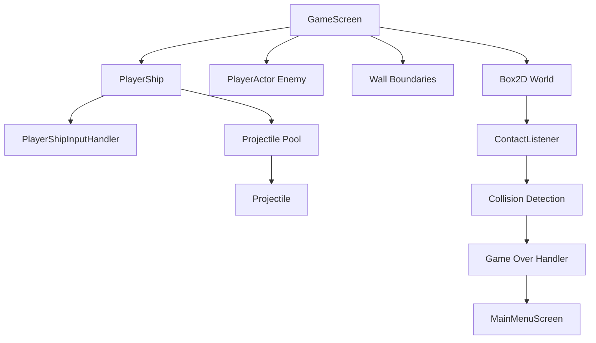

# Design Document: Player Controls and Shooting

## Overview

This design introduces a player-controlled ship entity with Asteroids-style physics-based controls and shooting mechanics to the existing libGDX game. The game window will be sized at 1600×1200 pixels with a virtual game field of 1600×1200 units (1:1 pixel-to-unit ratio), the existing PlayerActor (autonomous enemy) will be resized by 50x with dramatically enhanced speed and agility, and a new PlayerShip class will be created for player control at a similar 50x scale.

The PlayerShip will use arrow keys for rotation and thrust (similar to Asteroids), spacebar for shooting projectiles, and will trigger game over when colliding with walls. The design leverages the existing Box2D physics system, AnimatedPhysicsActor base class, and screen management architecture. The game window will be non-resizable to maintain consistent gameplay experience.

Key design decisions:
- 1:1 pixel-to-unit ratio eliminates scaling complexity and ensures precise positioning
- Game window is fixed size (non-resizable) to maintain consistent gameplay experience
- Wall boundaries positioned with bordersize offset (1 unit) from edges: bottom at y=1, top at y=1199, left at x=1, right at x=1599
- Wall boundaries are visible within the game field due to the bordersize offset
- PlayerShip spawns at exact center: (800, 600)
- PlayerShip extends AnimatedPhysicsActor to reuse physics and rendering infrastructure
- PlayerActor enhanced with extreme speed and agility: 25x faster movement (maxSpeed = 200f * scale), 40x stronger steering forces (maxForce = 20.0f * massScale), minimal physics damping (0.01f), aggressive wander behavior (1.5f orientation change rate), and immediate response smoothing (Smoother = 1)
- Keyboard input handled via libGDX InputProcessor for responsive controls
- Projectile lifecycle managed through Box2D contact listeners and boundary detection
- Game over transition uses existing screen management system

## Implementation Changes Made During Development

During implementation, several key values were adjusted from the original design to achieve the desired gameplay feel:

### Force Values Increased Dramatically
- **PlayerShip THRUST_FORCE**: Increased from 5.0f to **15000.0f** (3000x increase) to provide rapid acceleration and responsive movement
- **PlayerShip ROTATION_SPEED**: Changed from angular force to **constant rotation at 5.0f radians/second** for instant, precise control
- **PlayerShip MAX_LINEAR_VELOCITY**: Increased from 100.0f to **300.0f** for fast movement across the large game field
- These much higher values were necessary to overcome the physics body mass and provide responsive controls suitable for the large game field

### Projectile System: Hybrid Approach
- **Visual Speed**: 5000.0f pixels/second for smooth, fast visual movement
- **Physics Velocity**: 100.0f Box2D units/second for reliable collision detection
- **Lifetime**: Extended from 3.0f to **15.0f seconds** to allow projectiles to cross the large game field
- **Movement Method**: Direct position updates bypass Box2D velocity limitations while maintaining collision detection

### Projectile Spawn Position
- Projectiles spawn from ship tip with **30.0f * PPM pixel offset** from center, not from ship center
- This provides more realistic visual appearance of projectiles firing from the ship's front

### Control Direction Corrections
- **Left/Right rotation directions were swapped** during implementation to match intuitive controls
- **Up/down movement directions were corrected** to ensure proper thrust application

### Physics Configuration Optimizations
- **Projectile damping**: Set to **0.0f** (zero damping) for consistent movement without slowdown
- **PlayerShip damping**: Linear damping reduced to **0.1f**, angular damping set to **0.5f** for responsive Asteroids-style physics
- **Fire rate limiting**: Added **0.2 second cooldown** between shots to prevent projectile spam

### Collision System Enhancements
- Projectiles use **markForDeactivation()** system for safe collision handling
- Direct position updates ensure projectiles move at visual speed while maintaining physics collision detection
- Zero damping prevents projectiles from slowing down over their 15-second lifetime

## Architecture

### Component Overview



### Key Architectural Patterns

1. **Entity-Component Pattern**: PlayerShip and Projectile are physics-based actors inheriting from AnimatedPhysicsActor
2. **Input Handling**: Dedicated InputProcessor for keyboard controls, separate from touch input
3. **Object Pooling**: Projectile pool to avoid frequent allocation/deallocation
4. **Event-Driven Collision**: Box2D ContactListener for collision detection and game state transitions

### Integration Points

- **GameScreen**: Instantiates PlayerShip, manages projectile pool, handles game over transition
- **Box2D World**: Physics simulation for PlayerShip movement, projectile travel, and collision detection
- **Configuration**: New entity categories for PLAYER_SHIP and PROJECTILE
- **Screen Management**: Transition from GameScreen to MainMenuScreen on game over

## Components and Interfaces

### PlayerShip Class

```java
public class PlayerShip extends AnimatedPhysicsActor {
    // Constants - ACTUAL IMPLEMENTED VALUES
    private static final float ROTATION_SPEED = 5.0f;      // Radians/second for constant rotation
    private static final float THRUST_FORCE = 15000.0f;    // Much higher for rapid acceleration
    private static final float MAX_LINEAR_VELOCITY = 300.0f; // Much higher for fast movement
    private static final float FIRE_RATE_COOLDOWN = 0.2f;  // Fire rate limiting
    
    // State
    private boolean isAlive;
    private float lastFireTime;
    
    // Constructor
    public PlayerShip(String animationName, World world, float x, float y, 
                      int frameCols, int frameRows)
    
    // Control methods
    public void applyRotation(float direction) // 1 for CW, -1 for CCW (constant speed rotation)
    public void applyThrust(float direction)   // 1 for forward, -1 for reverse (rapid acceleration)
    public void shoot(ShootCallback callback)  // With fire rate limiting
    
    // State methods
    public boolean isAlive()
    public void destroy()
    public Vector2 getFacingDirection()
}
```

**Physics Configuration**:
- Body type: DynamicBody
- Collision category: PLAYER_SHIP
- Collision mask: BOUNDARY | PROJECTILE | ENEMY_SHIP
- Linear damping: 0.05f (reduced for responsive movement)
- Angular damping: 0.0f (zero damping for instant rotation stop)
- Constant rotation speed: 5.0f radians/second (no momentum-based rotation)
- Max linear velocity clamped to 300.0f for fast movement across large game field

### Projectile Class

```java
public class Projectile extends AnimatedPhysicsActor {
    // Constants - ACTUAL IMPLEMENTED VALUES
    private static final float PROJECTILE_SPEED = 5000.0f; // Pixels/second for visual movement
    private static final float PROJECTILE_LIFETIME = 15.0f; // Much longer than originally planned
    
    // State
    private float timeAlive;
    private boolean isActive;
    private Vector2 direction;
    private Vector2 currentPosition; // For direct position updates
    private boolean markedForDeactivation;
    
    // Constructor
    public Projectile(String animationName, World world, int frameCols, int frameRows)
    
    // Lifecycle methods
    public void fire(Vector2 position, Vector2 direction, Vector2 shipVelocity)
    public void deactivate()
    public boolean isActive()
    public void markForDeactivation() // For collision handling
    
    @Override
    public void act(float delta) // Hybrid movement: direct position updates + physics
}
```

**Physics Configuration**:
- Body type: DynamicBody
- Collision category: PROJECTILE
- Collision mask: BOUNDARY | ENEMY_SHIP
- Sensor: false (physical collision)
- Bullet: true (continuous collision detection for fast-moving objects)
- Linear damping: 0.0f (zero damping for consistent movement)
- Angular damping: 0.0f (zero damping)
- Hybrid movement system: 5000.0f pixels/second visual speed with 100.0f Box2D units/second physics velocity
- Direct position updates bypass Box2D velocity limitations while maintaining collision detection

### PlayerShipInputHandler Class

```java
public class PlayerShipInputHandler extends InputAdapter {
    private PlayerShip playerShip;
    private GameScreen gameScreen;
    
    // Key state tracking
    private boolean leftPressed;
    private boolean rightPressed;
    private boolean upPressed;
    private boolean downPressed;
    
    public PlayerShipInputHandler(PlayerShip ship, GameScreen screen)
    
    @Override
    public boolean keyDown(int keycode)
    
    @Override
    public boolean keyUp(int keycode)
    
    // Called each frame to apply forces based on key state
    public void update()
}
```

**Input Mapping**:
- Left Arrow (Input.Keys.LEFT): Clockwise constant rotation at 5.0f radians/second
- Right Arrow (Input.Keys.RIGHT): Counter-clockwise constant rotation at 5.0f radians/second
- Up Arrow (Input.Keys.UP): Forward thrust with rapid acceleration (15000.0f force)
- Down Arrow (Input.Keys.DOWN): Reverse thrust with rapid acceleration (15000.0f force)
- Spacebar (Input.Keys.SPACE): Shoot projectile (on keyDown only, with 0.2s fire rate limiting)

### ProjectilePool Class

```java
public class ProjectilePool {
    private static final int POOL_SIZE = 20;
    private Array<Projectile> pool;
    private World world;
    private Stage gameStage;
    
    public ProjectilePool(World world, Stage gameStage)
    
    public Projectile obtain(Vector2 position, Vector2 direction, Vector2 shipVelocity)
    public void free(Projectile projectile)
    public void updateAll(float delta)
    public void disposeAll()
}
```

### GameScreen Modifications

**New Fields**:
```java
private PlayerShip playerShip;
private ProjectilePool projectilePool;
private PlayerShipInputHandler playerShipInputHandler;
private boolean isGameOver;
```

**Modified Methods**:
- `constructor`: Set window size to 1600×1200 pixels (non-resizable), set VIRTUAL_WIDTH to 1600 and VIRTUAL_HEIGHT to 1200 (1:1 pixel-to-unit ratio), update wall boundaries with bordersize offset (1 unit) from edges: bottom at y=1, top at y=1199, left at x=1, right at x=1599
- `constructor`: Instantiate PlayerShip at exact center (800, 600) with 50x scale, create ProjectilePool, setup PlayerShipInputHandler
- `constructor`: Scale PlayerActor by 50x with enhanced performance characteristics
- `render(delta)`: Call playerShipInputHandler.update(), projectilePool.updateAll(delta)
- `dispose()`: Dispose projectilePool

**New Methods**:
```java
public void spawnProjectile(Vector2 position, Vector2 direction, Vector2 shipVelocity)
public void triggerGameOver()
```

### PlayerActor Enhancements

The existing PlayerActor (autonomous enemy) receives significant performance enhancements to create dynamic, fast-paced gameplay:

**Speed Enhancements**:
- **maxSpeed**: Increased from 8f to 200f (25x faster) - for 50x scale: 10,000 units/second
- **maxForce**: Increased from 0.5f to 20.0f (40x stronger) - for 50x scale: 50,000 force units

**Responsiveness Enhancements**:
- **linearDamping**: Reduced to 0.01f (extremely low resistance to movement changes)
- **angularDamping**: Reduced to 0.01f (extremely low resistance to rotation changes)
- **Smoother**: Reduced from 10 to 1 (minimal velocity smoothing for immediate response)

**Behavior Enhancements**:
- **wanderOrientation change rate**: Increased from 0.08f to 1.5f (aggressive direction changes)
- **Physics body scaling**: Properly scaled to match 50x visual size
- **Force scaling**: Forces scale with mass² to overcome increased physics body mass

**Implementation Details**:
```java
// Enhanced PlayerActor constructor (50x scale)
this.maxSpeed = 200f * scale;           // 10,000 units/sec
this.maxForce = 20.0f * massScale;      // 50,000 force units
this.body.setLinearDamping(0.01f);      // Minimal movement resistance
this.body.setAngularDamping(0.01f);     // Minimal rotation resistance

// Enhanced wander behavior
wanderOrientation += RandomBinomial() * 1.5f + bias;  // Aggressive turning

// Minimal smoothing for immediate response
private Smoother smoother = new Smoother(1, new Vector2(0f, 0f));

// Fixed Seek method for proper force application
public Vector2 Seek(Vector2 target){
    Vector2 desiredVelocity = target.sub(this.body.getPosition());
    desiredVelocity.nor();
    desiredVelocity.scl(this.maxSpeed); // Scale by maxSpeed for proper magnitude
    
    Vector2 steeringForce = desiredVelocity.cpy().sub(this.body.getLinearVelocity());
    steeringForce.limit(this.maxForce); // Limit by maxForce to prevent excessive forces
    return steeringForce;
}
```

These enhancements transform the PlayerActor from a slow, predictable enemy into a fast, agile, and unpredictable opponent that provides dynamic gameplay challenges. Additionally, a critical bug in the Seek method was fixed to ensure proper force scaling, allowing the PlayerActor to actually achieve the enhanced movement speeds.

### ContactListener Enhancement

Extend the existing ContactListener in GameScreen to handle:

1. **PlayerShip-Wall Collision**: Trigger game over
2. **Projectile-Wall Collision**: Deactivate projectile
3. **Projectile-Enemy Collision**: Deactivate projectile (future: damage enemy)

```java
@Override
public void beginContact(Contact contact) {
    Fixture fixtureA = contact.getFixtureA();
    Fixture fixtureB = contact.getFixtureB();
    
    // Check for PlayerShip-Wall collision
    if (isCollision(fixtureA, fixtureB, PLAYER_SHIP, BOUNDARY)) {
        triggerGameOver();
    }
    
    // Check for Projectile-Wall collision
    if (isCollision(fixtureA, fixtureB, PROJECTILE, BOUNDARY)) {
        Projectile proj = getProjectileFromFixtures(fixtureA, fixtureB);
        if (proj != null) proj.deactivate();
    }
    
    // Existing collision logic...
}

private boolean isCollision(Fixture a, Fixture b, short cat1, short cat2) {
    return (a.getFilterData().categoryBits == cat1 && 
            b.getFilterData().categoryBits == cat2) ||
           (a.getFilterData().categoryBits == cat2 && 
            b.getFilterData().categoryBits == cat1);
}
```

### Configuration Updates

Add new entity categories:

```java
public static enum EntityCategory {
    BOUNDARY((short) 0x1),
    PLAYER((short) 0x2),
    ENEMY_SHIP((short) 0x3),
    CONTROL_POINT((short) 0x4),
    PLAYER_SHIP((short) 0x5),      // New
    PROJECTILE((short) 0x6);        // New
    
    // ... existing code
}
```

## Data Models

### PlayerShip State

```java
{
    position: Vector2,           // World coordinates
    velocity: Vector2,           // Linear velocity
    angle: float,                // Rotation in radians
    angularVelocity: float,      // Rotation speed
    isAlive: boolean,            // Game state
    body: Body                   // Box2D physics body
}
```

### Projectile State

```java
{
    position: Vector2,           // World coordinates
    velocity: Vector2,           // Linear velocity
    angle: float,                // Rotation in radians
    timeAlive: float,            // Seconds since fired
    isActive: boolean,           // Whether in use
    body: Body                   // Box2D physics body
}
```

### Input State

```java
{
    leftPressed: boolean,
    rightPressed: boolean,
    upPressed: boolean,
    downPressed: boolean,
    spacePressed: boolean
}
```

### Game State

```java
{
    isGameOver: boolean,
    gameOverTimer: float         // Countdown to screen transition
}
```


## Correctness Properties

*A property is a characteristic or behavior that should hold true across all valid executions of a system-essentially, a formal statement about what the system should do. Properties serve as the bridge between human-readable specifications and machine-verifiable correctness guarantees.*

### Property 1: Physics Body Matches Visual Size

*For any* AnimatedPhysicsActor, the physics body dimensions should match the visual texture dimensions scaled by the appropriate factor.

**Validates: Requirements 2.2**

### Property 2: Arrow Key Rotation Direction

*For any* PlayerShip state, pressing the left arrow key should apply counter-clockwise angular force, and pressing the right arrow key should apply clockwise angular force.

**Validates: Requirements 4.1, 4.2**

### Property 3: Thrust Direction Alignment

*For any* PlayerShip orientation, pressing the up arrow should apply thrust force in the facing direction, and pressing the down arrow should apply thrust force opposite to the facing direction.

**Validates: Requirements 4.3, 4.4**

### Property 4: Continuous Rotation on Key Hold

*For any* duration of arrow key press, the PlayerShip should continue to have rotational force applied each frame until the key is released.

**Validates: Requirements 4.6**

### Property 5: Projectile Spawns at Ship Position

*For any* PlayerShip position and orientation, pressing spacebar should spawn a Projectile at the ship's current position.

**Validates: Requirements 5.1**

### Property 6: Projectile Direction Matches Ship Facing

*For any* PlayerShip orientation at time of firing, the projectile's velocity direction should match the ship's facing direction.

**Validates: Requirements 5.2**

### Property 7: Projectile Faster Than Ship

*For any* PlayerShip velocity, the projectile's velocity magnitude should be greater than the ship's velocity magnitude.

**Validates: Requirements 5.3**

### Property 8: Projectile Removal on Boundary Exit

*For any* projectile that exits the game field boundaries, it should be deactivated and removed from the active projectile pool.

**Validates: Requirements 5.5**

### Property 9: Wall Collision Blocks Movement

*For any* PlayerShip-Wall collision, the PlayerShip should be physically blocked from passing through the wall (non-sensor collision response).

**Validates: Requirements 6.1**

### Property 10: Wall Collision Triggers Game Over

*For any* collision between PlayerShip and Wall boundary, the game should transition to a game over state and then to the MainMenuScreen.

**Validates: Requirements 7.1, 7.2**

### Property 11: Game Over Transition Timing

*For any* game over trigger, the transition to MainMenuScreen should occur within 1 second of the collision event.

**Validates: Requirements 7.3**

### Property 12: Resource Disposal on Screen Transition

*For any* screen transition from GameScreen to MainMenuScreen, all game resources (world, stages, textures) should be properly disposed before the transition completes.

**Validates: Requirements 7.4**

## Error Handling

### Input Handling Errors

**Scenario**: Multiple conflicting keys pressed simultaneously (e.g., left and right arrows)
- **Handling**: Apply net force based on most recent key press, or cancel opposing forces
- **Implementation**: Track key press timestamps in PlayerShipInputHandler

**Scenario**: Rapid spacebar presses (projectile spam)
- **Handling**: Implement fire rate limiting (e.g., 0.2 second cooldown between shots)
- **Implementation**: Track lastFireTime in PlayerShip, reject fire() calls within cooldown period

### Physics Errors

**Scenario**: PlayerShip velocity exceeds reasonable bounds
- **Handling**: Clamp linear velocity to maximum speed (e.g., 10 units/second)
- **Implementation**: In PlayerShip.act(), check and clamp velocity magnitude

**Scenario**: Angular velocity causes excessive spinning
- **Handling**: Clamp angular velocity to MAX_ANGULAR_VELOCITY
- **Implementation**: In PlayerShip.applyRotation(), clamp body.getAngularVelocity()

**Scenario**: Projectile pool exhausted (all 20 projectiles active)
- **Handling**: Reuse oldest active projectile or ignore fire request
- **Implementation**: ProjectilePool.obtain() returns null if pool exhausted, PlayerShip.shoot() handles null gracefully

### Collision Detection Errors

**Scenario**: Collision event fires multiple times for single contact
- **Handling**: Use game over flag to prevent multiple transitions
- **Implementation**: Check isGameOver flag before triggering transition in ContactListener

**Scenario**: Projectile collides with multiple entities in same frame
- **Handling**: Deactivate on first collision, ignore subsequent collisions
- **Implementation**: Check projectile.isActive() before processing collision

### Resource Management Errors

**Scenario**: Screen transition occurs before physics world step completes
- **Handling**: Set flag to defer transition until after world.step()
- **Implementation**: Check pendingGameOver flag at end of render(), then transition

**Scenario**: Projectile body accessed after deactivation
- **Handling**: Null-check body before accessing in Projectile methods
- **Implementation**: Set body reference to null on deactivation, guard all body access

## Testing Strategy

### Unit Testing Approach

Unit tests will focus on specific examples, edge cases, and integration points:

**PlayerShip Tests**:
- Test initial spawn position matches expected coordinates
- Test applyRotation() with positive/negative values applies correct torque
- Test applyThrust() applies force in correct direction based on angle
- Test shoot() returns null when fire rate cooldown active
- Test destroy() sets isAlive to false

**Projectile Tests**:
- Test fire() sets velocity to ship velocity + direction * speed
- Test act() deactivates projectile after PROJECTILE_LIFETIME seconds
- Test deactivate() sets isActive to false and stops physics body

**ProjectilePool Tests**:
- Test obtain() returns active projectile from pool
- Test obtain() returns null when pool exhausted
- Test free() returns projectile to pool and deactivates it
- Test updateAll() calls act() on all active projectiles

**GameScreen Tests**:
- Test window size equals 1600×1200 pixels
- Test window is non-resizable (resizable flag set to false)
- Test VIRTUAL_WIDTH equals 1600 and VIRTUAL_HEIGHT equals 1200
- Test 1:1 pixel-to-unit ratio is maintained
- Test PlayerActor texture dimensions are 50x original size
- Test PlayerActor has enhanced speed parameters: maxSpeed = 200f * scale, maxForce = 20.0f * massScale
- Test PlayerActor has minimal damping: linearDamping = 0.01f, angularDamping = 0.01f
- Test PlayerActor has aggressive wander behavior: wanderOrientation change rate = 1.5f
- Test PlayerActor has minimal smoothing: Smoother value = 1
- Test PlayerActor Seek method properly scales desired velocity by maxSpeed and limits by maxForce
- Test PlayerShip spawns at exact center (800, 600) with 50x scale
- Test triggerGameOver() sets isGameOver flag and schedules transition
- Test wall boundaries positioned with bordersize offset: bottom at y=1, top at y=1199, left at x=1, right at x=1599

**ContactListener Tests**:
- Test PlayerShip-Wall collision triggers game over
- Test Projectile-Wall collision deactivates projectile
- Test collision detection ignores already-processed collisions

### Property-Based Testing Approach

Property tests will verify universal behaviors across randomized inputs using a property-based testing library (jqwik for Java). Each test will run a minimum of 100 iterations.

**Property Test Configuration**:
- Library: jqwik (already in use based on .jqwik-database file)
- Iterations: 100 minimum per property
- Tag format: `@Tag("Feature: player-controls-and-shooting, Property N: [property text]")`

**Property 1: Physics Body Matches Visual Size**
- Generate: Random AnimatedPhysicsActor instances with various texture sizes
- Test: Verify body.getFixtureList().get(0).getShape() dimensions match texture dimensions / PPM
- Tag: `Feature: player-controls-and-shooting, Property 1: Physics body matches visual size`

**Property 2: Arrow Key Rotation Direction**
- Generate: Random PlayerShip states (various positions, angles, velocities)
- Test: Apply left key input, verify angular velocity becomes negative; apply right key, verify positive
- Tag: `Feature: player-controls-and-shooting, Property 2: Arrow key rotation direction`

**Property 3: Thrust Direction Alignment**
- Generate: Random PlayerShip orientations (angles 0-2π)
- Test: Apply up thrust, verify force vector aligns with facing direction; apply down thrust, verify opposite
- Tag: `Feature: player-controls-and-shooting, Property 3: Thrust direction alignment`

**Property 4: Continuous Rotation on Key Hold**
- Generate: Random key hold durations (0.1-2.0 seconds)
- Test: Simulate key held for duration, verify rotation force applied every frame
- Tag: `Feature: player-controls-and-shooting, Property 4: Continuous rotation on key hold`

**Property 5: Projectile Spawns at Ship Position**
- Generate: Random PlayerShip positions within game field
- Test: Call shoot(), verify projectile position equals ship position within tolerance
- Tag: `Feature: player-controls-and-shooting, Property 5: Projectile spawns at ship position`

**Property 6: Projectile Direction Matches Ship Facing**
- Generate: Random PlayerShip orientations (angles 0-2π)
- Test: Fire projectile, verify velocity direction matches ship facing direction within tolerance
- Tag: `Feature: player-controls-and-shooting, Property 6: Projectile direction matches ship facing`

**Property 7: Projectile Faster Than Ship**
- Generate: Random PlayerShip velocities (0-10 units/sec in random directions)
- Test: Fire projectile, verify projectile velocity magnitude > ship velocity magnitude
- Tag: `Feature: player-controls-and-shooting, Property 7: Projectile faster than ship`

**Property 8: Projectile Removal on Boundary Exit**
- Generate: Random projectile positions outside boundaries
- Test: Call updateAll(), verify projectiles outside boundaries are deactivated
- Tag: `Feature: player-controls-and-shooting, Property 8: Projectile removal on boundary exit`

**Property 9: Wall Collision Blocks Movement**
- Generate: Random PlayerShip positions near walls with velocities toward walls
- Test: Simulate collision, verify ship position does not pass through wall
- Tag: `Feature: player-controls-and-shooting, Property 9: Wall collision blocks movement`

**Property 10: Wall Collision Triggers Game Over**
- Generate: Random PlayerShip-Wall collision scenarios
- Test: Trigger collision, verify isGameOver flag set and screen transition scheduled
- Tag: `Feature: player-controls-and-shooting, Property 10: Wall collision triggers game over`

**Property 11: Game Over Transition Timing**
- Generate: Random game over trigger times
- Test: Measure time from trigger to screen transition, verify ≤ 1 second
- Tag: `Feature: player-controls-and-shooting, Property 11: Game over transition timing`

**Property 12: Resource Disposal on Screen Transition**
- Generate: Random GameScreen states before transition
- Test: Trigger transition, verify dispose() called on world, stages, and textures
- Tag: `Feature: player-controls-and-shooting, Property 12: Resource disposal on screen transition`

### Integration Testing

**Full Gameplay Flow**:
1. Start game from MainMenuScreen
2. Verify GameScreen loads with 1600×1200 pixel window (non-resizable) and 1600×1200 virtual units (1:1 ratio)
3. Verify PlayerShip spawns at exact center (800, 600) with 50x scale and responds to input
4. Fire projectiles and verify they travel correctly
5. Collide with wall and verify game over transition
6. Verify return to MainMenuScreen

**Input Integration**:
1. Test InputMultiplexer correctly routes keyboard input to PlayerShipInputHandler
2. Test simultaneous touch input (for control points) and keyboard input don't interfere
3. Test input handling during screen transitions

**Physics Integration**:
1. Test PlayerShip, PlayerActor, and Projectiles all interact correctly with Box2D world
2. Test collision filtering prevents unwanted collisions (e.g., PlayerShip-PlayerActor)
3. Test physics simulation remains stable with multiple active projectiles

### Manual Testing Checklist

- [ ] Game window is 1600×1200 pixels and non-resizable
- [ ] Game field uses 1:1 pixel-to-unit ratio (1600×1200 virtual units)
- [ ] Wall boundaries are positioned with bordersize offset: bottom at y=1, top at y=1199, left at x=1, right at x=1599
- [ ] Wall boundaries are visible within the game field
- [ ] PlayerShip spawns at exact center (800, 600) with 50x scale
- [ ] PlayerActor enemy appears 50x larger with dramatically enhanced speed and agility
- [ ] PlayerActor moves extremely fast (25x faster than original speed)
- [ ] PlayerActor turns aggressively with rapid direction changes
- [ ] PlayerActor responds immediately to steering forces with minimal smoothing
- [ ] PlayerShip has distinct visual appearance and is similarly sized to PlayerActor (50x scale)
- [ ] Arrow key controls feel responsive and smooth
- [ ] Rotation behaves like Asteroids (continuous, momentum-based)
- [ ] Spacebar fires projectiles in facing direction
- [ ] Projectiles travel faster than ship
- [ ] Projectiles disappear when leaving screen
- [ ] Ship cannot pass through walls
- [ ] Colliding with wall triggers game over within 1 second
- [ ] Game returns to main menu after game over
- [ ] No memory leaks or resource issues after multiple play sessions
