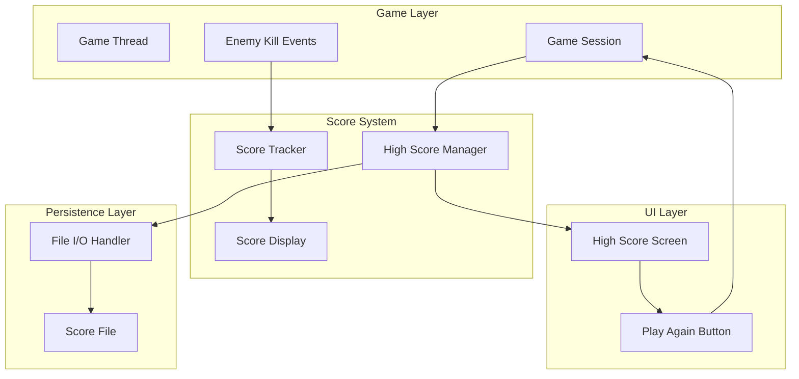

# Design Document: Score Tracking System

## Overview

The Score Tracking System is a comprehensive scoring mechanism for the UberPlayground LibGDX game that provides real-time score display, persistent high score storage, and an engaging post-game experience. The system consists of four main components working together to track player performance and encourage replay through competitive scoring.

The architecture follows a separation of concerns approach where score tracking, display, persistence, and UI presentation are handled by distinct components. This design ensures maintainability while providing a smooth user experience from gameplay through game over to restart.

## Architecture

The Score Tracking System follows a layered architecture with clear separation between game logic, data persistence, and user interface components:



### Component Interaction Flow

1. **Score Tracking Flow**: Enemy kill events trigger score increments in the Score Tracker, which immediately updates the Score Display
2. **Persistence Flow**: Game over events trigger the High Score Manager to save scores through the File I/O Handler to the Score File
3. **Display Flow**: The High Score Screen reads persisted scores through the High Score Manager and presents them with restart functionality

## Components and Interfaces

### Score Tracker Component

**Responsibilities:**
- Track current game session score
- Increment score on enemy kill events
- Reset score for new game sessions
- Provide current score to display components

**Interface:**
```java
public class ScoreTracker {
    public void incrementScore()
    public int getCurrentScore()
    public void resetScore()
    public void addScoreListener(ScoreListener listener)
}
```

**Key Behaviors:**
- Maintains thread-safe score counter for concurrent access
- Notifies registered listeners immediately on score changes
- Provides atomic score operations to prevent race conditions

### Score Display Component

**Responsibilities:**
- Render current score at top middle of screen
- Update display in real-time as score changes
- Maintain consistent visual presentation during gameplay

**Interface:**
```java
public class ScoreDisplay implements ScoreListener {
    public void render(SpriteBatch batch)
    public void onScoreChanged(int newScore)
    public void setPosition(float x, float y)
}
```

**Key Behaviors:**
- Implements observer pattern to receive score updates
- Uses LibGDX BitmapFont for consistent text rendering
- Positions text centered horizontally at top of screen

### High Score Manager Component

**Responsibilities:**
- Read and write high score data to persistent storage
- Maintain top 5 scores in sorted order
- Handle file I/O errors gracefully
- Validate and parse score data

**Interface:**
```java
public class HighScoreManager {
    public void saveScore(int score)
    public List<Integer> getTopScores()
    public boolean isHighScore(int score)
    private void writeScoresToFile(List<Integer> scores)
    private List<Integer> readScoresFromFile()
}
```

**Key Behaviors:**
- Maintains in-memory cache of high scores for performance
- Sorts scores in descending order before persistence
- Implements error recovery for corrupted or missing files
- Validates integer parsing with graceful failure handling

### High Score Screen Component

**Responsibilities:**
- Display top 5 high scores in formatted list
- Highlight player's current score if in top 5
- Provide "Play Again" button for game restart
- Handle screen transitions and input events

**Interface:**
```java
public class HighScoreScreen implements Screen {
    public void show()
    public void render(float delta)
    public void handleInput()
    public void dispose()
}
```

**Key Behaviors:**
- Loads high scores on screen activation
- Renders scores with visual hierarchy and highlighting
- Manages button input and screen transitions
- Implements LibGDX Screen interface for game state management

## Data Models

### Score Data Structure

The system uses simple integer values for scores with the following characteristics:

**Score Value:**
- Type: 32-bit signed integer
- Range: 0 to 2,147,483,647
- Increment: +1 per enemy kill
- Initial Value: 0 for new game sessions

**High Score Collection:**
- Container: ArrayList<Integer>
- Capacity: Maximum 5 entries
- Ordering: Descending (highest to lowest)
- Persistence: Plain text file format

### File Format Specification

**File Location:** `./highscores.txt` (project root directory)

**File Structure:**
```
[score1]\n
[score2]\n
[score3]\n
[score4]\n
[score5]\n
```

**Format Rules:**
- Each line contains a single integer value
- Lines are terminated with newline characters
- File contains maximum 5 lines
- Empty file is valid (represents no high scores)
- Invalid lines are skipped during parsing

**Example File Content:**
```
1250
1100
950
800
650
```

### Memory Management

**Score Tracker State:**
- Current score: Single integer field
- Score listeners: WeakReference collection to prevent memory leaks
- Thread safety: AtomicInteger for concurrent access

**High Score Manager Cache:**
- In-memory list: ArrayList<Integer> with maximum 5 elements
- Cache invalidation: On file write operations
- Memory footprint: Minimal (5 integers + collection overhead)
## Correctness Properties

*A property is a characteristic or behavior that should hold true across all valid executions of a system-essentially, a formal statement about what the system should do. Properties serve as the bridge between human-readable specifications and machine-verifiable correctness guarantees.*

### Property 1: Score Tracking Operations

*For any* sequence of enemy kill events and game session resets, the score tracker should increment by exactly the number of kill events since the last reset, and new game sessions should always start with zero score.

**Validates: Requirements 1.1, 4.3**

### Property 2: Score Display Updates

*For any* score change event, the score display component should receive the update notification immediately and reflect the new score value.

**Validates: Requirements 1.3**

### Property 3: High Score Persistence Round Trip

*For any* valid score value, saving it to the score file and then reading the file back should preserve the score value in the correct integer format on its own line.

**Validates: Requirements 2.1, 2.5, 5.2, 5.3, 5.4**

### Property 4: Top 5 Score Limit Invariant

*For any* number of scores saved to the high score system, the score file should never contain more than 5 entries.

**Validates: Requirements 2.2**

### Property 5: Score Sorting Invariant

*For any* collection of scores in the high score file, they should always be ordered from highest to lowest value.

**Validates: Requirements 2.3**

### Property 6: Invalid Data Parsing Resilience

*For any* score file containing a mix of valid integer lines and invalid non-integer lines, the high score manager should successfully parse all valid scores while skipping invalid lines without crashing.

**Validates: Requirements 5.5**

### Property 7: Error Handling Resilience

*For any* file I/O error condition (write failures, read failures, permission errors), the score tracking system should continue normal operation without crashing, and score tracking should remain functional even when persistence fails.

**Validates: Requirements 6.1, 6.3, 6.4**

### Property 8: High Score Screen Loading

*For any* high score file state, when the high score screen loads, it should display the top 5 scores in descending order, or an empty list if the file is unreadable.

**Validates: Requirements 3.2, 3.3**

## Error Handling

The Score Tracking System implements comprehensive error handling to ensure game stability and user experience continuity:

### File I/O Error Recovery

**Write Operation Failures:**
- Log error details for debugging purposes
- Continue game operation without score persistence
- Maintain in-memory score tracking functionality
- Display user-friendly message if appropriate

**Read Operation Failures:**
- Default to empty high score list display
- Log error for diagnostic purposes
- Allow normal game flow to continue
- Gracefully handle missing or corrupted files

### Data Validation and Parsing

**Score File Corruption:**
- Skip malformed lines during parsing
- Process valid entries and ignore invalid ones
- Maintain partial high score list if some data is recoverable
- Prevent crashes from unexpected file formats

**Integer Overflow Protection:**
- Use appropriate data types for score values
- Handle edge cases near maximum integer values
- Implement bounds checking for score operations

### Component Isolation

**Failure Containment:**
- Score tracking operates independently of persistence
- Display updates continue even if file operations fail
- Game session management remains functional during I/O errors
- User interface remains responsive during background operations

## Testing Strategy

The Score Tracking System requires a dual testing approach combining unit tests for specific scenarios and property-based tests for comprehensive validation:

### Unit Testing Approach

**Specific Example Tests:**
- File creation when highscores.txt doesn't exist (Requirements 2.4)
- Empty high score display when file is corrupted (Requirements 3.4, 6.2)
- Correct file location usage (Requirements 5.1)
- Game state transitions and UI interactions
- Edge cases like maximum score values and empty files

**Integration Tests:**
- Component interaction between Score Tracker and Score Display
- High Score Manager integration with file system
- Screen transitions from game over to high score display
- End-to-end score tracking through complete game sessions

### Property-Based Testing Configuration

**Testing Framework:** Use QuickCheck for Java or similar property-based testing library for LibGDX projects

**Test Configuration:**
- Minimum 100 iterations per property test to ensure comprehensive input coverage
- Custom generators for score values, file states, and game events
- Shrinking support to identify minimal failing cases

**Property Test Implementation:**
Each correctness property must be implemented as a single property-based test with the following tag format:

```java
// Feature: score-tracking-system, Property 1: Score Tracking Operations
@Property
void scoreTrackingOperations(@ForAll List<GameEvent> events) { ... }

// Feature: score-tracking-system, Property 2: Score Display Updates  
@Property
void scoreDisplayUpdates(@ForAll int scoreChange) { ... }

// Feature: score-tracking-system, Property 3: High Score Persistence Round Trip
@Property
void highScorePersistenceRoundTrip(@ForAll int score) { ... }

// Feature: score-tracking-system, Property 4: Top 5 Score Limit Invariant
@Property
void top5ScoreLimitInvariant(@ForAll List<Integer> scores) { ... }

// Feature: score-tracking-system, Property 5: Score Sorting Invariant
@Property
void scoreSortingInvariant(@ForAll List<Integer> scores) { ... }

// Feature: score-tracking-system, Property 6: Invalid Data Parsing Resilience
@Property
void invalidDataParsingResilience(@ForAll List<String> fileLines) { ... }

// Feature: score-tracking-system, Property 7: Error Handling Resilience
@Property
void errorHandlingResilience(@ForAll IOErrorCondition errorType) { ... }

// Feature: score-tracking-system, Property 8: High Score Screen Loading
@Property
void highScoreScreenLoading(@ForAll FileState fileState) { ... }
```

### Test Data Generation

**Score Value Generators:**
- Valid score range: 0 to Integer.MAX_VALUE
- Edge cases: 0, 1, maximum values
- Invalid cases: negative numbers for error testing

**File State Generators:**
- Valid files with 0-5 scores
- Corrupted files with mixed valid/invalid data
- Missing files and permission-denied scenarios
- Empty files and files with trailing whitespace

**Game Event Generators:**
- Enemy kill event sequences of varying lengths
- Game session reset events
- Mixed event sequences for complex scenarios

This comprehensive testing strategy ensures both concrete behavior validation through unit tests and universal correctness guarantees through property-based testing, providing confidence in the system's reliability across all possible inputs and scenarios.